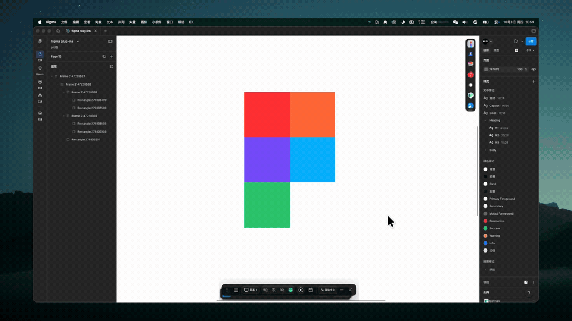

# Figma Ratio Grid（中文说明见下）



Adds a **ratio grid** to Figma Desktop: click the **W / H** input in the properties panel, pick a preset ratio (1:1, 4:3, 16:9 …), and every selected layer is resized to that ratio instantly — no more manual width/height typing or lock-ratio dragging.

Fully standalone — no Figma plugin installation, no dependency on any community tool.

## Interaction

| Action | Result |
|---|---|
| Click the **Width** input | Grid pops up → picking a ratio **keeps width, adjusts height** |
| Click the **Height** input | Grid pops up → picking a ratio **keeps height, adjusts width** |
| Select a layer | No popup (won't interrupt your normal workflow) |
| Pick a ratio / Esc / Enter / click elsewhere | Grid closes |

Multi-select supported.

## Install (macOS)

Requires Node.js ≥ 18.

```bash
git clone https://github.com/mufanmu/Figma-Extension.git
cd figma-ratio-grid
node scripts/install.js
```

Then **fully quit Figma (⌘Q) and reopen**. Select a layer, click the W or H input.

The installer: ① patches `app.asar` (81-byte in-place replacement, auto-backup, idempotent) to keep the local debug port open — the same patch FigmaEX relies on, so EX users can skip it; ② installs a LaunchAgent that auto-injects every newly opened Figma page; ③ injects currently open pages.

## Uninstall

```bash
node scripts/uninstall.js
# optionally restore the original asar:
cp .../app.asar.bak .../app.asar
```

## After a Figma update

Updates overwrite `app.asar`. Just re-run:

```bash
node scripts/patch.js && node scripts/inject.js
```

## How it works

```
app.asar ──[patch.js: 81-byte equal-length binary swap]──> port 9222
inject.js --watch (LaunchAgent) ── CDP WebSocket → injects src/ratio-inject.js
  └─ anchors: input[aria-label="Width"/"Height"], resizes via figma API
```

Zero npm dependencies. See 中文 README above for details.

## Notes

- Patching the app bundle is the same risk level as FigmaEX and similar tools. The debug port binds to 127.0.0.1 only.
- macOS only for now (Figma Desktop 126.x / UI3). Windows port welcome via PR.

## License

MIT
